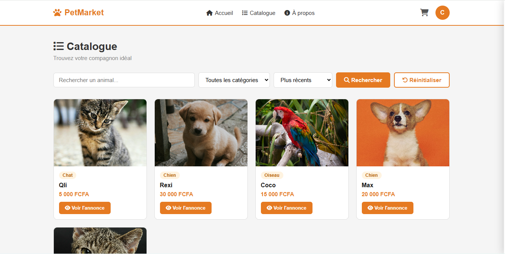

# PetMarket

Place de marché web qui met en relation vendeurs et acheteurs d'animaux à Lomé : catalogue, recherche par catégorie, panier et réservation.



## Le problème

Les éleveurs de Lomé vendaient surtout par WhatsApp et bouche-à-oreille, sans visibilité. PetMarket leur donne une vitrine, et donne aux acheteurs un catalogue où chercher.

## Fonctionnalités

- **Visiteurs** : accueil, page « à propos », catalogue filtrable par catégorie (chien, chat, lapin, oiseau), fiche détaillée de chaque animal.
- **Acheteurs** : inscription / connexion, profil, panier, validation de commande. Le profil doit contenir téléphone et ville avant de commander, car le vendeur en a besoin pour les contacter.
- **Vendeurs** : publication et gestion de leurs annonces (photo, prix, âge, description), notifications sur les commandes reçues. Un acheteur peut demander à devenir vendeur.
- **Administrateur** : gestion des animaux et des demandes de passage en vendeur.
- Cycle de vie d'une annonce : `disponible` → `reserve` → `vendu` (ou `en_attente`).
- À la commande, l'animal est verrouillé en base (transaction + `FOR UPDATE`) : deux acheteurs ne peuvent pas réserver le même animal en même temps.

## Stack

PHP 8 (PDO) · MySQL / MariaDB · HTML · CSS · JavaScript (catalogue et panier en AJAX) · Bootstrap Icons.

## Installation (Windows + XAMPP)

Prérequis : XAMPP (PHP 8.x, Apache, MySQL).

1. Copier le dossier dans `C:\xampp\htdocs\PetMarket`. **Le nom du dossier doit être exactement `PetMarket`** : les redirections du projet pointent vers `/PetMarket/`.
2. Démarrer **Apache** et **MySQL**.
3. Dans phpMyAdmin, créer la base `petmarket` puis importer `petmarket.sql`.
4. Accès à la base dans `config/database.php` (par défaut `root` sans mot de passe, réglages XAMPP).
5. Ouvrir `http://localhost/PetMarket/`.

## Structure

```
index.php        routeur (table de routage ?page=...)
controllers/     logique de chaque écran et actions AJAX
models/          accès aux données (animal, user, panier, commande, categorie)
views/           pages PHP (accueil, catalogue, profil, vendeur, admin)
public/          CSS, JavaScript, images
config/          base de données et réglages
petmarket.sql    structure et données de démonstration
```

## Ce que j'ai appris

- Structurer une base pour un catalogue riche (animaux, catégories, utilisateurs, panier, commandes).
- Gérer trois rôles (acheteur, vendeur, admin) avec des pages réservées.
- Éviter une double réservation grâce aux transactions SQL.
- Faire dialoguer le navigateur et le serveur en AJAX (réponses JSON).

## Limites connues et pistes d'amélioration

- Pas de paiement en ligne : la mise en relation se fait par téléphone, le paiement reste hors plateforme.
- Le chemin `/PetMarket/` est écrit en dur dans plusieurs fichiers ; une constante de configuration serait plus propre.
- Photos contrôlées par l'extension, pas par le contenu réel du fichier.

## Contexte

Projet réalisé en 2026 dans le cadre du BTS en développement d'applications à DEFITECH (Lomé).

**Auteur** : ASSAN Ablavi Clever, [GitHub](https://github.com/clever75)
